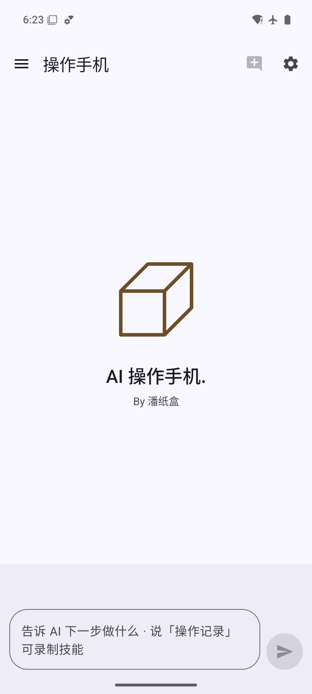
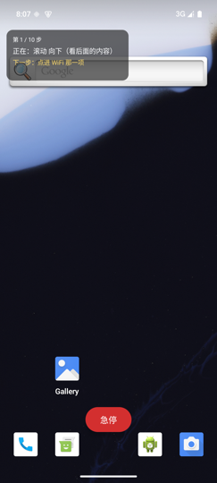
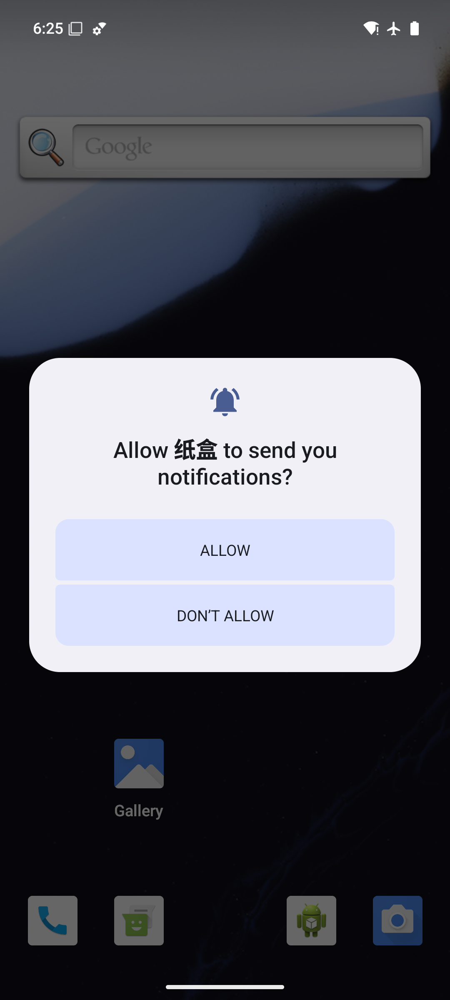

# 纸盒

**让 AI 直接操作你的安卓手机。**

用一句话说清楚你要干什么，它自己看屏幕、点按钮、输入文字，一步步把事做完。

不需要 root，不需要电脑，主流程也不依赖 Shizuku（只有"副屏"这个可选功能要用它）。
装上一个 APK、开一次无障碍权限就能用——不想花钱填 API Key 也行，内置免费模型通道，开箱即用。

> 名字来自作者「潘纸盒」，图标就是一个纸板箱。

---

## 它能做什么

- **听懂人话去操作手机**：「打开 WiFi」「把屏幕亮度调低」「去设置里看看还剩多少存储」
- **不挑应用**：微信、抖音、设置、各类工具类 App 都能点，因为它操作的就是屏幕上真实的东西
- **边做边告诉你下一步**：屏幕底部的悬浮条实时显示"正在做什么"和"接下来打算做什么"，觉得不对**随时按急停**
- **点在哪看得见**：每次操作屏幕对应位置会闪一圈蓝色水波，是"点错了"还是"点对了但没反应"，一眼就能分辨
- **自带记忆和技能**：能查手机上装了哪些应用（不用你告诉它包名），记得住你上一句话，也能把习惯沉淀成长期记忆
- **会开网页**：需要读网页时它自己开一个内置浏览器，读的是页面 DOM，比"看截图猜"准得多
- **能挂副屏**：配好 Shizuku 后可以把 AI 的操作搬到一块虚拟屏上，主屏照常自己用
- **可以定时**：定时任务到点自动跑，适合"每天早上看一眼天气"这类重复事
- **完整日志**：每一步做了什么、模型返回了什么原始内容、截图，全部留在本地，可一键导出 zip 反馈

## 长什么样

| 主界面 | 悬浮窗与落点水波 | 设置页 |
|---|---|---|
|  |  |  |

## 两种模型模式

设置页顶部一键切换：

| 模式 | 说明 |
|---|---|
| **自定义模型** | 填你自己的 OpenAI 兼容接口地址、API Key 和模型名。支持一键拉取模型列表。 |
| **免费模型** | 走社区免密聚合网关，不用填 Key。**模型列表打开时用接口实时读取**（网关 `/zen/v1/models`，读不到自动退回内置名单），有速率限制，适合先试玩。 |

思考强度是一条滑块，**档位按你用的通道不同**（都是读接口文档定的，不是拍脑袋）：

| 通道 | 可选档位 |
|---|---|
| DeepSeek 官方 | `OFF → LOW → HIGH → MAX → 默认 → 自定义` |
| 其它 OpenAI 兼容 | `OFF → LOW → MED → HIGH → 默认 → 自定义` |
| 免费通道 | `OFF → LOW → HIGH → 默认 → 自定义` |

每一档在设置页直接显示**实际会发的接口参数**（`thinking.type` / `reasoning_effort`）；
「默认」= 什么都不发、由接口自己的默认决定（DeepSeek：思考默认开启、默认 high）；
「自定义」= 自己填 `reasoning_effort`（服务商词表各不相同，写死一张表必然过时），留空同样什么都不发。
免费通道有例外：上游拒收 `thinking:disabled`，所以 OFF 档在免费通道**不发**这个字段（界面会如实写出来）。

## 环境要求

- **Android 9 及以上**（`minSdk 28`；目前主要在 Android 13 / 15 模拟器与一台 Android 16 真机上验证过）
- 无障碍权限（装完会引导你开）
- 自定义模式：一个 OpenAI 兼容接口的 API Key（DeepSeek、OpenRouter、本地 Ollama 都行）
- 免费模式：什么都不用准备
- 副屏（可选）：装 Shizuku 并启动它的服务。这条链路 0.10.3 起在 AVD 上跑通了，真机仍在逐项验收

## 安装

1. 从 [Releases](https://github.com/panzih/AI-phone-use-bypanzhihe/releases) 下载最新 APK
2. 允许"安装未知来源应用"
3. 打开 App，按引导开无障碍权限
4. 选"免费模型"直接开始，或切到"自定义"填你自己的 Key

## 项目结构

```
app/src/main/java/com/aiphone/assistant/
├── MainActivity.kt       组装依赖、跑任务、界面路由（也承担任务生命周期）
├── ChannelController.kt  选通道、探前台、读控件树/截图，对上隐藏通道差异
├── a11y/        无障碍服务：读控件树、点按、手势、自动截图
├── agent/       主循环：看屏幕 → 想 → 点 → 再看；提示词、动作解析、端侧规则
├── browser/     内置浏览器通道（把 DOM 摘要映射成控件树里的元素）
├── channel/     设备通道抽象：无障碍 / 副屏 两种实现
├── data/        设置持久化、思考档位、上下文（含历史图片）落盘、API Key 加密
├── display/     虚拟副屏：建屏、销毁、镜像
├── llm/         模型调用（自定义 + 免费双通道）、模型列表、语音探针
├── log/         每步日志、自动截图、导出 zip
├── memory/      长期记忆
├── overlay/     悬浮窗：底部进度条、暂停/急停、落点水波
├── record/      操作录制（入口当前不开放，见下）
├── schedule/    定时任务：持久化、闹钟排程、开机重排
├── shell/       Shizuku / ADB 通道的 shell 服务（AIDL）
├── skill/       模型可调用的本地技能（应用列表、记忆）
├── touch/       手势与动作数据模型
└── ui/          Compose 界面（主界面 / 权限 / 设置 / 关于 / 定时任务）
```

`record/` 的录制能力还在，但入口按 0.9.23 的计划先收起来了（`ui/UiState.kt` 的
`RECORDING_ENTRY_ENABLED = false`），所以界面上看不到它。

## 安全说明

- **API Key 只存在你手机上**：正常情况下 AES-256-GCM 加密，密钥在系统 Keystore 里
  （不可导出），落盘的只有密文；老版本存过的明文会在下次读取时自动加密写回。
  Key 只会发给你自己填的那个模型接口，不会被发到别处。**例外要说清楚**：系统加密接口万一失败（极罕见），
  会退回明文保存并记一条日志——宁可降级也不让你填了 Key 存不上
- 导出日志时 device.txt 里的 API Key 会自动打码
- 接口地址填成公网 `http://` 时，设置页会常驻一条黄色警告（明文过网的风险）
- 免费模式用的是公开聚合网关，**请求里不附加你的任何账号标识**——
  但要说全：**屏幕内容、你输入的文字和你说的话本身就会发给模型**，免费通道也一样
- 日志、截图、对话上下文默认都留在本机，只有你主动导出才会离开手机
- 无广告、无统计、无后台联网（除了你主动发模型请求）

## 开源协议

[MIT](LICENSE)

用到的开源组件见 App 内「关于 → 开源软件许可」。

## 作者

潘纸盒 · [Issues](https://github.com/panzih/AI-phone-use-bypanzhihe/issues) · [Releases](https://github.com/panzih/AI-phone-use-bypanzhihe/releases)
